# 🚀 Awesome AI Software Engineering

**A Curated Index of SaaS Control Planes, Autonomous Coding Agents, Open-Source Frameworks & Spec-Driven SDLC Platforms**

*Empowering developers, platform architects, and engineering leaders to plan, build, review, and ship software with AI agents across every stage of the development lifecycle.*

[Explore SaaS Platforms](#-saashosted-platforms) • [Open-Source Solutions](#-open-source-github-projects) • [Spec-Driven Paradigms](#-emerging-ai-software-engineering-paradigms) • [Contributing](#-how-to-contribute)

---

## 📑 Table of Contents

- [🌟 Highlights &amp; Key Themes](#-highlights--key-themes)
- [🌐 Sector Overview &amp; Market Dynamics](#-sector-overview--market-dynamics)
- [🏢 SaaS/Hosted Platforms](#-saashosted-platforms)
- [💻 Open-Source GitHub Projects](#-open-source-github-projects)
  - [⭐ Open-Source Software Engineering Ecosystem (Ranked by GitHub_Stars)](#-open-source-software-engineering-ecosystem-ranked-by-github-stars)
  - [🧬 AI-Native Specification &amp; Multi-Agent Frameworks](#-ai-native-specification--multi-agent-frameworks)
- [🧠 Emerging AI Software Engineering Paradigms](#-emerging-ai-software-engineering-paradigms)
- [🤝 How to Contribute](#-how-to-contribute)
- [💖 Support &amp; Community](#-support--community)
- [⭐ Star History](#-star-history)
- [⚖️ Disclaimer &amp; Security Considerations](#-disclaimer--security-considerations)
- [🏷️ SEO Metadata &amp; Topic Tags](#-seo-metadata--topic-tags)

---

## 🌟 Highlights & Key Themes

- 🤖 **Autonomous Coding Agents**: AI entities that navigate codebases, execute terminal shell commands, edit multi-file patches, run tests, and open GitHub PRs autonomously.
- 📐 **Spec-Driven Development (SDD)**: Shifting focus from informal prompt engineering to structured, version-controlled Markdown artifacts (`Specify → Plan → Tasks → Implement → Converge`).
- 🎯 **Issue Trackers as Agent Control Planes**: Modern issue systems (Linear, Jira, GitHub Issues) becoming the primary dispatch interface where work items serve as actionable agent prompts.
- 🔓 **Self-Hosted Freedom**: Full-stack open-source alternatives providing vendor independence, on-premises privacy, and zero data leakage for enterprise codebases.

---

## 🌐 Sector Overview & Market Dynamics

> [!NOTE]
> ### 📊 Sector Overview & Market Dynamics
> The global **AI Software Engineering, Developer Tooling, and Agentic SDLC market** is estimated at **$28.5 Billion in 2026** (projected to exceed **$52 Billion by 2030** with an aggressive CAGR of ~24–28%).
> 
> The sector exhibits **moderate fragmentation with dual-tier concentration**:
> - **Top-Tier Concentration ("Winner-Take-Most" Control Planes)**: Incumbent developer platforms and enterprise suite giants—predominantly **Microsoft (GitHub / Azure DevOps)** and **Atlassian (Jira)**—control distribution, core repositories, and centralized project databases, locking in enterprise governance and compliance.
> - **High Peripheral Fragmentation**: At the execution and agent orchestration layer, the market is intensely fragmented among innovative SaaS startups (e.g., Linear, ClickUp, Cursor) and thriving open-source frameworks (e.g., OpenHands, MetaGPT, Cline, Aider, Plane). Teams frequently pair an established issue tracker as the control plane with modular, specialized open-source coding agents for automated implementation.

---

## 🏢 SaaS/Hosted Platforms

The table below catalogs leading SaaS platforms acting as control planes and project management hubs for AI software delivery.

*Sorted by **Company Size (Valuation / Revenue)** in descending order:*

| 🏢 SaaS Platform & Control Plane | 📈 Company Size (Valuation / Revenue) | 💵 Starting Pricing (Specific Paid Tier) | 🎁 Free Tier Limits / Free Trial Terms | 🎯 Key Capabilities & AI Agent Integration |
| :--- | :--- | :--- | :--- | :--- |
| **[Azure DevOps](https://azure.microsoft.com/en-us/products/devops/)** ☁️ | **$3.12+ Trillion** Market Cap / **$245B+** Revenue *(Microsoft Parent)* | **$6.00 / user / month** *(Basic Plan, billed monthly for user 6+)* | **Free forever for first 5 Basic users**; includes Azure Boards, Repos & Artifacts (2 GiB storage) + **1 free CI/CD parallel job** (1,800 min/mo Microsoft-hosted or 1 self-hosted runner unlimited min) + **unlimited free Stakeholders**. | Enterprise backlog planning, sprint boards, Git repos, CI/CD pipelines, and test management. Integrated with GitHub Copilot and Azure OpenAI services. |
| **[GitHub Issues & Projects](https://github.com/features/issues)** 🐙 | **$7.5+ Billion** Acquisition Valuation / **$2B+** ARR *(Microsoft Subsidiary)* | **$4.00 / user / month** *(Team tier, billed annually at $44/yr or $4.17 billed monthly)* | **Free forever** with unlimited public/private repositories, unlimited collaborators, 500 MB GitHub Packages storage, and **2,000 CI/CD Action minutes / month**. | Native issue tracking, project boards, and roadmap views. Serves as primary dispatch plane for GitHub Copilot Workspace and coding agents via issue assignment or `@mention`. |
| **[Atlassian Jira](https://www.atlassian.com/software/jira)** 🔷 | **$48.5 Billion** Market Cap *(NASDAQ: TEAM)* / **$4.4B+** Revenue | **$7.75 / user / month** *(Standard plan, billed annually at $77.50/user/yr or $8.15 billed monthly)* | **Free forever for up to 10 users**, 2 GB total workspace storage, unlimited Scrum/Kanban boards, backlog planning, and **100 automation rule runs / month**. | Enterprise standard for agile sprint management, JQL queries, audit trails, and SSO/SAML. Direct assignment integration with Cursor, Copilot coding agents, and Atlassian Intelligence. |
| **[Monday.com](https://monday.com/)** 📊 | **$13.5 Billion** Market Cap *(NASDAQ: MNDY)* / **$970M+** Revenue | **$9.00 / seat / month** *(Basic plan billed annually, $12 billed monthly; 3-seat minimum = $27/mo)* | **Free forever for up to 2 seats**, up to 3 active boards, 200 items (tasks), 500 MB file storage, and 200+ templates (excludes automations and third-party integrations). | Work OS featuring customizable boards, automated workflows, and dashboards. monday AI powers automated status updates, task triage, and developer workflow automation. |
| **[ClickUp](https://clickup.com/)** ⚡ | **$4.0 Billion** Valuation *(Series C)* / **$150M+** ARR | **$7.00 / user / month** *(Unlimited plan billed annually, $10 billed monthly)* | **Free forever with unlimited members** and unlimited tasks; capped at **100 MB workspace storage**, 100 automation executions / month, and 60 uses of custom fields and Gantt charts. | All-in-one productivity suite with docs, whiteboards, goals, and sprints. ClickUp Brain provides AI-driven task management, auto-generated subtasks, and workspace search. |
| **[Asana](https://asana.com/)** 🌸 | **$3.2 Billion** Market Cap *(NYSE: ASAN)* / **$700M+** Revenue | **$10.99 / user / month** *(Starter plan billed annually, $13.49 billed monthly; 2-seat minimum)* | **Free forever for up to 2 users**, unlimited tasks, unlimited projects, unlimited messages, **100 MB per file attachment limit**, and 3 board views (List, Board, Calendar). | Work management platform with visual timelines, Gantt roadmaps, and Asana Intelligence for workload balancing, automated project summaries, and GitHub sync. |
| **[Planview](https://www.planview.com/)** 🏛️ | **$1.6 Billion** Valuation *(TPG / TA Associates)* / **$400M+** Revenue | **$19.00 / user / month** *(AgilePlace edition, billed annually)* | **30-day full-featured free trial** for ProjectPlace & AgilePlace with unlimited Kanban boards, roadmaps, and document management (no credit card required; no permanent free tier). | Enterprise portfolio management and Strategic Portfolio Management (SPM/PPM). Facilitates Scaled Agile Frameworks (SAFe) and value stream management across large engineering orgs. |
| **[Linear](https://linear.app/)** 📐 | **$400 Million** Valuation *(Series B by Accel)* / **$25M+** ARR | **$10.00 / user / month** *(Basic plan billed annually, $12 billed monthly)* | **Free forever for unlimited members** and up to 2 teams; capped at **250 active non-archived issues** and a 10 MB file upload limit. | High-speed, keyboard-first issue tracker with 2-week cycles, roadmaps, and API-first architecture. Linear Agent enables native AI coding agent dispatch via issue assignment or `@mention`. |
| **[Shortcut](https://shortcut.com/)** 🔀 | **$150 Million** Valuation *(Series B)* / **$12M+** ARR | **$8.50 / user / month** *(Team plan billed annually, $10 billed monthly)* | **Free forever for up to 10 users**, unlimited Docs, basic reporting, roadmaps, and integrations with GitHub, GitLab, and Slack. | Fast developer-centric project management combining stories, epics, and iterations with automated branch tracking and pull request status synchronization. |
| **[Targetprocess](https://www.apptio.com/products/targetprocess/)** 🎯 | **$120 Million** Division Valuation / **$4.6B** Apptio / **$200B+** IBM Parent | **$20.00 / user / month** *(Standard enterprise cloud tier via G-Cloud / procurement, min 10 users)* | **30-day enterprise evaluation trial** with unlimited users, unlimited projects/entities, and full access to agile planning boards upon demo registration. | Enterprise Agile planning and portfolio management supporting SAFe, LeSS, and custom business agility models with deep integrations into IBM Apptio and CI/CD pipelines. |

---

## 💻 Open-Source GitHub Projects

Open-source solutions provide developer autonomy, self-hosted data isolation, and deep extensibility.

### ⭐ Open-Source Software Engineering Ecosystem (Ranked by GitHub_Stars)

*Sorted by **GitHub Stars_Count** in descending order:*

1. **[All-Hands-AI / OpenHands](https://github.com/All-Hands-AI/OpenHands)**  🤖  
   *The premier open-source AI software development agent (formerly OpenDevin).* Capable of executing bash commands, reading/editing full codebases, running test suites, resolving GitHub issues, and opening complete pull requests autonomously.

2. **[AppFlowy-IO / AppFlowy](https://github.com/appflowy-io/appflowy)**  📑  
   *Open-source, self-hosted workspace and project management alternative to Notion and Linear.* Built with Flutter and Rust, featuring AI-assisted document drafting, custom Kanban pipelines, and offline-first data sovereignty.

3. **[Geekan / MetaGPT](https://github.com/geekan/MetaGPT)**  👥  
   *Multi-agent software engineering framework simulating an entire software team.* Takes a one-line prompt requirement and orchestrates simulated Product Managers, Architects, Project Managers, and Engineers to output PRDs, API designs, tasks, and full code implementations.

4. **[Cline / Cline](https://github.com/cline/cline)**  🛠️  
   *Autonomous AI coding assistant for VS Code and CLI.* Directly modifies multi-file directories, executes shell commands, analyzes terminal outputs, and builds end-to-end features with step-by-step human verification loops.

5. **[MakePlane / Plane](https://github.com/makeplane/plane)**  ✈️  
   *Modern open-source software project management and issue tracker built as an extensible alternative to Jira and Linear.* Features cycles, modules, roadmaps, analytics, and rich webhooks for AI agent dispatch.

6. **[Go-Gitea / Gitea](https://github.com/go-gitea/gitea)**  🍵  
   *Painless, lightweight self-hosted Git service written in Go.* Features integrated issue tracking, pull request code reviews, milestone scheduling, Gitea Actions CI, and webhook dispatch for AI bot workflows.

7. **[Odoo / Odoo](https://github.com/odoo/odoo)**  📦  
   *Modular open-source business and ERP platform with comprehensive Project and Helpdesk modules.* Supports Agile Kanban flows, Gantt charts, automated task escalation, and automated issue routing.

8. **[Aider-AI / Aider](https://github.com/Aider-AI/aider)**  🧑‍💻  
   *Leading AI pair programming terminal tool.* Edits local git repositories, executes multi-file code modifications, creates structured git commit messages automatically, and pairs with local or cloud LLMs.

9. **[Frappe / ERPNext](https://github.com/frappe/erpnext)**  🏭  
   *Full-featured open-source ERP system.* Includes dedicated agile project management, bug tracking, task allocation, timesheets, and milestone tracking built on the reactive Frappe framework.

10. **[ContinueDev / Continue](https://github.com/continuedev/continue)**  ⏩  
    *The leading open-source AI code assistant extension for VS Code and JetBrains.* Connects custom local (Ollama/vLLM) or remote models, enables codebase-wide contextual search, and auto-generates unit tests and documentation.

11. **[OpenBMB / ChatDev](https://github.com/OpenBMB/ChatDev)**  🏢  
    *Virtual software development company powered by multi-agent conversational design.* Agents take specialized roles (CEO, CPO, CTO, Programmer, Reviewer, Tester) and communicate through chat chains to specify, code, test, and document software systems.

12. **[TabbyML / Tabby](https://github.com/TabbyML/tabby)**  🐱  
    *Self-hosted AI coding assistant for secure, private enterprise environments.* Delivers fast inline code completions and repository-level contextual chat without sending code outside your private network.

13. **[Pythagora-io / GPT-Pilot](https://github.com/Pythagora-io/gpt-pilot)**  🧭  
    *Autonomous AI developer tool that writes full apps from scratch.* Breaks applications into architectural steps, asks clarifying questions, codes feature-by-feature, and debugs runtime errors iteratively.

14. **[Mattermost / Focalboard](https://github.com/mattermost/focalboard)**  📋  
    *Self-hosted open-source alternative to Trello, Notion, and Asana.* Provides Kanban boards, tables, calendars, and gallery views with native integration into Mattermost collaboration hubs.

15. **[GitLab Community Edition / GitLab](https://github.com/gitlabhq/gitlabhq)**  🦊  
    *Complete open-source DevOps and lifecycle platform.* Offers unified issues, epics, sprint planning boards, CI/CD pipelines, and programmable webhooks for automated AI agent triggers.

16. **[Wekan / Wekan](https://github.com/wekan/wekan)**  📑  
    *Popular open-source Kanban board built with Meteor.* Supports swimlanes, card dependencies, custom fields, user permissions, and on-premise installation.

17. **[OpenProject / OpenProject](https://github.com/opf/openproject)**  🏰  
    *Comprehensive enterprise open-source project management suite.* Features Agile boards, Gantt roadmaps, bug tracking, cost reporting, and strict data privacy compliance (GDPR).

18. **[SweepAI / Sweep](https://github.com/sweepai/sweep)**  🧹  
    *Open-source AI junior developer that turns GitHub issues into bug fixes and feature PRs.* Reads issue descriptions, searches codebase symbols, modifies code, and triggers CI checks.

19. **[Redmine / Redmine](https://github.com/redmine/redmine)**  💎  
    *Battle-tested, flexible open-source project management web application.* Features issue tracking, Gantt charts, wikis, per-project forums, role-based access, and an extensive Ruby plugin ecosystem.

20. **[MantisBT / MantisBT](https://github.com/mantisbt/mantisbt)**  🦗  
    *Lightweight open-source bug tracker.* Built in PHP/MySQL, renowned for effortless installation, email notifications, multi-project support, and reliable issue triage.

21. **[Bugzilla / Bugzilla](https://github.com/bugzilla/bugzilla)**  🦖  
    *The historic, enterprise-grade defect tracking system developed by Mozilla.* Engineered for massive scale, advanced search filters, scheduled reports, and rock-solid reliability.

22. **[Taiga / Taiga-Back](https://github.com/taigaio/taiga-back)**  🎯  
    *Agile project management platform for Scrum and Kanban teams.* Features intuitive sprint backlogs, epics, user stories, issue tracking, and customizable dashboards.

23. **[Edgewall / Trac](https://github.com/edgewall/trac)**  🚂  
    *Minimalist, enhanced wiki and issue tracking system for software engineering.* Integrates seamlessly with Subversion and Git, providing seamless hyperlinking across code revisions and tickets.

---

### 🧬 AI-Native Specification & Multi-Agent Frameworks

These tools power the emerging **Spec-Driven Development (SDD)** paradigm—turning issues and requirements into structured Markdown specifications and automated agent pipelines:

- **[GitHub Spec Kit](https://github.com/github/spec-kit)** 📘  
  *The reference toolkit for AI-first, spec-driven engineering (MIT, Microsoft).* Moves specification ahead of implementation (**Specify → Plan → Tasks → Implement → Converge**) so AI coding agents work from structured Markdown artifacts instead of ambiguous chat prompts. Features 38+ tool integrations (Copilot, Claude, Gemini, Codex), 150+ community extensions, and reusable role-based bundles.

- **[nspec](https://pypi.org/project/nspec/)** 📝  
  *Specification-driven project management for AI-native development.* Converts your backlog into structured Markdown specifications with feature request and implementation pairing (`FR/IMPL`). Features a 6-layer validation engine, MCP server support (stdio/SSE/HTTP), and `/nloop` for autonomous agent execution.

- **[Forge](https://pypi.org/project/forge-orchestrator/)** 🔨  
  *CLI-first multi-agent orchestration for auditable software delivery.* Implements a staged role pipeline: Critic (00) → Architect (01) → Planner (02) → Executor (03) → Tester (04) → Reviewer (05) → post-execution Critic (06). Employs diff-first adversarial review and empirical testing via Playwright and CLI binaries.

- **[ASE (Agentic Software Engineer)](https://pypi.org/project/agentic-software-engineer/)** 🦾  
  *Framework transforming work tickets into code, tests, docs, and deployments.* Uses specialized agents for backend, frontend, security, and DevOps with custom system prompts, `SKILL.md` modules, MCP servers, and comprehensive OpenTelemetry tracing (`trace_id`, `span_id`).

---

## 🧠 Emerging AI Software Engineering Paradigms

> [!TIP]
> ### 🔑 Core Architectural Tenets of Modern AI Software Engineering
>
> 1. **Spec-Driven Development (SDD) is the New Baseline**: Prompt engineering alone does not scale to multi-file refactors or complex business logic. Structured specifications act as deterministic contracts that both human architects and AI agents read, validate, and refine.
> 2. **Issue Trackers as Agent Control Planes**: Platforms like GitHub Issues, Jira, and Linear now serve as the centralized prompt interface. Assigning a ticket or mentioning `@agent` dispatches tasks with full contextual backlinks, milestones, and reproduction steps.
> 3. **Adversarial Diff-First Code Reviews**: Rather than trusting full agent generations, modern pipelines treat the Git diff as the primary review artifact, testing changes against automated black-box suites and lint barriers before merging.
> 4. **Safe Agentic Sandboxing**: Production agent workflows require status-echo contracts, rate limits, CI token isolation, and automated kill switches to prevent runaway PR creation and unbounded API consumption.

---

## 🤝 How to Contribute

Contributions are warmly welcomed! Help keep this ecosystem guide up-to-date, factual, and comprehensive:

1. 🍴 **Fork the repository**.
2. 🌿 **Create a new branch**: `git checkout -b feature/add-new-tool`
3. ✏️ **Edit `README.md`**:
   - For SaaS products: Include Name, Link, Company Size (Valuation/Revenue), exact starting tier pricing, and exact free tier limits.
   - For Open-Source projects: Include repository URL, social Stars_Badge linking to `/stargazers`, and a concise 1–2 sentence description. Place the entry in the correct star-sorted position.
4. 🚀 **Commit your changes**: `git commit -m "feat: add NewTool to open-source ecosystem"`
5. 📤 **Push and submit a Pull Request**.

⭐ *If you find this repository valuable, please consider giving it a star!*

---

## 💖 Support & Community

Thank you for exploring and supporting the **Awesome AI Software Engineering** ecosystem! 

If you find this repository helpful:
- ⭐ **Star this repository** to help other engineers, platform teams, and architects discover it!
- 🍴 **Fork and contribute** by adding new tools, benchmarks, or specs.
- 📢 **Share it** with your network, team, or developer communities.
- ☕ **Buy a coffee & sponsor**: If you would like to support ongoing maintenance, research, and curation of open-source resources, please consider sponsoring via the [GitHub Sponsor Dashboard](https://github.com/sponsors/ishandutta2007).

---

## ⭐ Star History

---

## ⚖️ Disclaimer & Security Considerations

- 🛡️ **Community Curated**: This repository is a curated index maintained for informational and educational purposes; inclusion does not imply official endorsement.
- 🔒 **Data Privacy & Compliance**: AI software engineering agents process source code, architectural designs, and proprietary issue data. Always verify compliance with GDPR, SOC 2, HIPAA, and IP indemnification policies before connecting coding agents to private enterprise repositories.
- 🛡️ **Autonomous PR Safety**: Autonomous agent dispatch should always require human pull request reviews, authenticated webhooks, and sandboxed execution environments.

---

## 🏷️ SEO Metadata & Topic Tags

`ai-software-engineering` • `software-engineering` • `ai-agents` • `autonomous-agents` • `sdlc` • `developer-tools` • `spec-driven-development` • `agentic-workflows` • `coding-assistants` • `jira-alternatives` • `linear-alternatives` • `open-source` • `self-hosted` • `awesome-list` • `curated-list` • `devops` • `project-management` • `mcp` • `multi-agent-systems`

---

  <b>Built with ❤️ for engineering leaders, platform teams, and developers building the future of AI-driven software delivery.</b>

